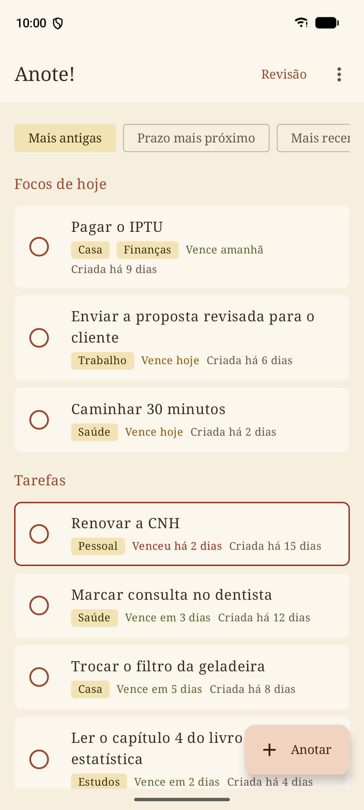
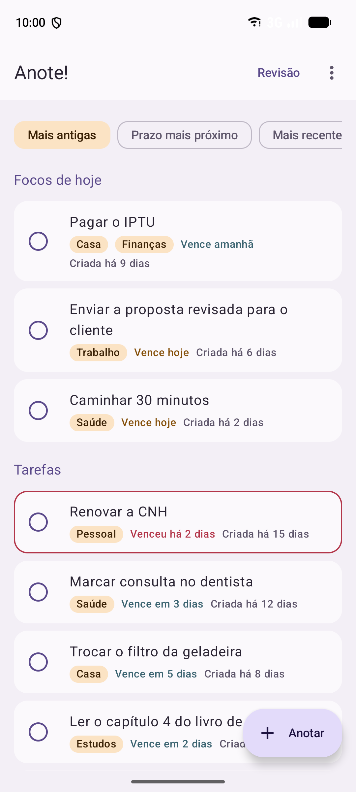
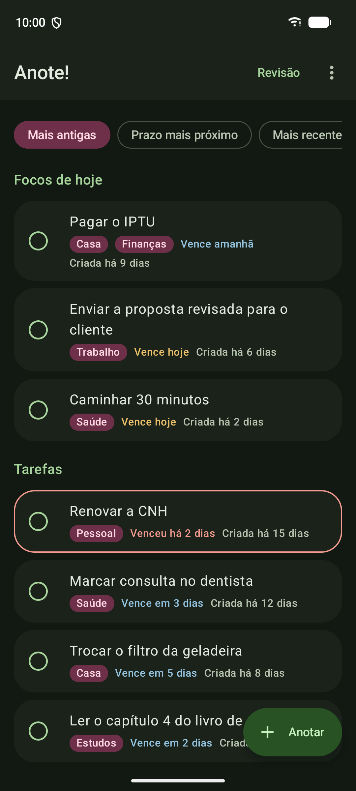
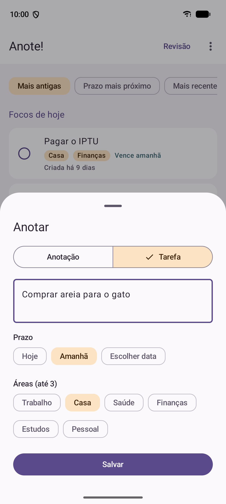
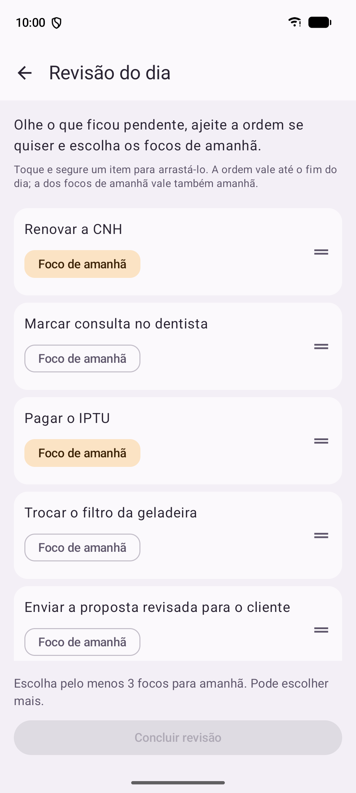
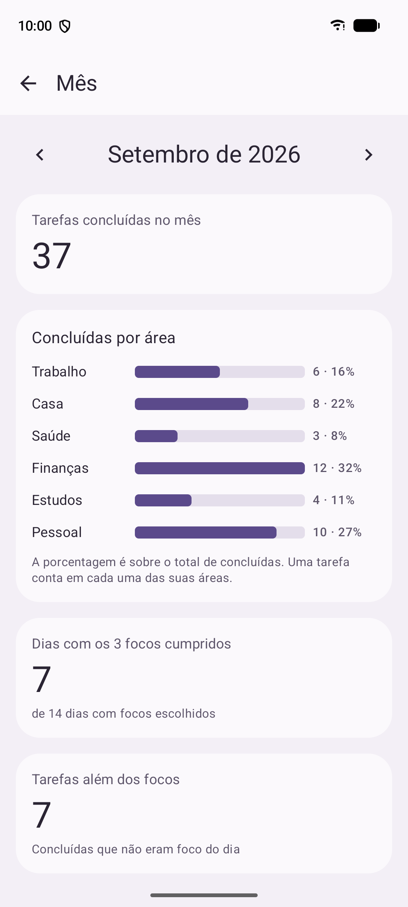
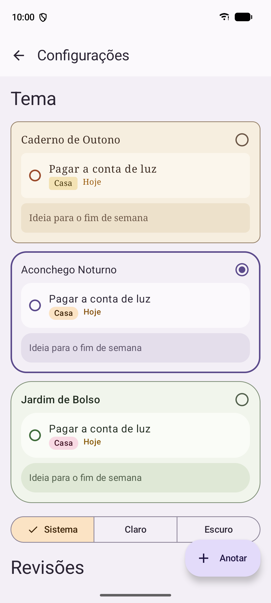

<div align="center">


### Tarefas e ideias do dia, focos à noite, o mês em perspectiva.

Um app Android pessoal, local e sem conta, para anotar o que surge ao longo do dia,<br>
escolher os focos de amanhã na revisão da noite e ver, no fim do mês, o que você realizou em cada área da vida.

[](https://github.com/Raphael-GC/Anote/releases/latest)


</div>

---

<p align="center">
  
  &nbsp;
  
  &nbsp;
  
</p>
<p align="center"><sub>A mesma lista nos três temas: Caderno de Outono, Aconchego Noturno e Jardim de Bolso (escuro).</sub></p>

## Como o dia funciona

O Anote! é construído em torno de um ritmo simples, sem metas infladas nem pontuação.

1. **Ao longo do dia, anote.** Um toque em **Anotar** abre a captura rápida, de qualquer tela ou direto do widget. Escolha entre *anotação* (uma ideia, sem prazo) e *tarefa* (com prazo e até 3 áreas).
2. **Às 21h, revise.** A revisão diária mostra o que ficou pendente, da mais antiga para a mais recente. Arraste para reordenar e escolha **pelo menos 3 focos** para amanhã. O que não foi concluído volta sozinho no dia seguinte.
3. **No domingo às 19h, olhe a semana.** Um resumo do que foi concluído, adicionado e dos focos cumpridos, uma triagem das pendências mais antigas (manter, reagendar ou descartar) e um lembrete de backup.
4. **No fim do mês, veja o todo.** O painel mostra quanto você concluiu, em quais áreas, em quantos dias cumpriu os 3 focos e como as tarefas se distribuem pela semana.

<p align="center">
  
  &nbsp;
  
  &nbsp;
  
  &nbsp;
  
</p>
<p align="center"><sub>Captura rápida · Revisão do dia · Painel do mês · Configurações</sub></p>

## Funcionalidades

**Lista principal**
- Focos do dia sempre no topo; o restante por idade, da mais antiga para a mais recente.
- Ordenações alternativas: *prazo mais próximo* e *mais recentes*. Os focos continuam no topo em qualquer uma.
- Cada item mostra áreas, prazo (vencido, hoje, próximos dias) e há quanto tempo foi criado. A data de criação nunca muda, nem quando o prazo é adiado.
- Tarefas vencidas mantêm a posição e ganham destaque. Anotações ficam numa seção própria.
- Conclusão com animação discreta e vibração leve.
- Concluiu por engano? A mensagem que aparece oferece **Desfazer** na hora, e a tela **Concluídas**, no menu, permite desfazer depois.

**Captura e edição**
- Captura rápida em bottom sheet, acessível de qualquer tela.
- Prazo obrigatório para tarefas, editável depois. Áreas (até 3) também editáveis a qualquer momento.
- Uma anotação pode virar tarefa quando ganhar prazo.

**Revisões e lembretes**
- Revisão diária e revisão de domingo com horários configuráveis (padrão 21h e 19h).
- Ordem manual por arraste, que vale até o fim do dia.
- Descartar uma pendência na triagem de domingo também pode ser desfeito.
- Lembretes das revisões e do backup ligados por padrão; aviso de prazo opcional (às 9h), desligado por padrão.

**Widget**
- Focos de hoje na tela inicial e atalho para a captura rápida, com a tipografia de cada tema.

**Temas**
- Três temas, cada um com versão clara e escura: **Caderno de Outono**, **Aconchego Noturno** e **Jardim de Bolso**.
- O tema muda só a aparência; textos e comportamento são iguais nos três.
- Modo claro, escuro ou seguindo o sistema. Sem cores dinâmicas.

## Seus dados ficam com você

- **Nada sai do aparelho.** O app não declara a permissão de internet, não tem conta, servidor, analytics nem relatório de falhas remoto.
- **Backup automático diário** numa pasta escolhida por você: armazenamento interno, cartão, pen drive ou uma pasta do Google Drive (se o app do Drive estiver instalado), via seletor do sistema. Os 7 arquivos mais recentes são mantidos.
- **Aviso de permissão perdida.** Se a pasta deixar de estar acessível, o app avisa na próxima gravação.
- **Exportar e importar em JSON** a qualquer momento, com prévia das contagens antes de importar e os modos *mesclar* (padrão) ou *substituir*. O arquivo leva um `schemaVersion` para que versões futuras saibam lê-lo.
- **Escolha consciente no primeiro uso.** O onboarding só termina depois que você escolhe uma pasta de backup ou confirma que quer seguir sem backup.
- O banco interno e as preferências ficam fora do backup automático do Android. O controle de cópias é seu.

## O que o Anote! não faz, de propósito

Sem sequências, selos, contadores de progresso ou plantinhas que crescem. Sem tarefas recorrentes, sem compartilhamento e sem sincronização. As áreas são definidas no onboarding e depois ficam fixas, para que o painel do mês compare sempre as mesmas coisas.

## Instalação

1. Baixe o `Anote-v*.apk` da [página de releases](https://github.com/Raphael-GC/Anote/releases/latest).
2. Abra o arquivo no celular e permita a instalação de apps desta fonte, se o Android pedir.
3. Requer **Android 14** ou mais recente.

Trocando de aparelho? Instale o app, escolha *Importar dados* nas Configurações e selecione o último arquivo de backup.

## Compilando

Requisitos: Android Studio recente (com o JDK embutido) e o Android SDK com a plataforma da versão alvo.

```bash
git clone https://github.com/Raphael-GC/Anote.git
cd Anote
./gradlew assembleDebug          # APK de debug em app/build/outputs/apk/debug/
./gradlew testDebugUnitTest      # testes unitários
```

<details>
<summary><b>Gerando um APK de release assinado</b></summary>

O build de release procura a chave em `~/.android/anote-signing.properties`, fora do repositório:

```properties
storeFile=/caminho/para/sua-chave.jks
storePassword=...
keyAlias=...
keyPassword=...
```

Com o arquivo presente, `./gradlew assembleRelease` gera `app/build/outputs/apk/release/app-release.apk` assinado. Sem ele, o APK de release sai sem assinatura.

</details>

## Por dentro

| | |
|---|---|
| Linguagem e UI | Kotlin, Jetpack Compose, Material 3 |
| Dados | Room (registros, áreas, focos, revisões) e DataStore (preferências) |
| Agendamento | WorkManager para revisões, lembretes e backup automático |
| Widget | Jetpack Glance |
| Arquivos | Storage Access Framework para a pasta de backup, exportação e importação |
| Testes | JUnit e Robolectric: regras do repositório, ordenação, agregação do painel, ida e volta do backup e validação de `schemaVersion` |

```
app/src/main/java/net/oraphael/anote/
├── data/          # Room, DataStore, regras de lista, focos, revisões e painel
│   ├── backup/    # JSON, backup automático, rotação dos 7 arquivos
│   └── reminders/ # lembretes das revisões, do backup e aviso de prazo
├── ui/            # telas em Compose: lista, captura, revisões, painel, onboarding, configurações
│   └── theme/     # tokens de design e os três temas
└── widget/        # widget Glance
```

## Estado do projeto

A versão 1.0 cobre todas as funcionalidades planejadas. A fase final de QA em aparelho real (backup em pen drive e Google Drive, perda de permissão de pasta, widget em cada tema e painel com meses de uso real) está em andamento.

### Próxima versão

A próxima versão traz animações e tipografia pensadas para cada tema, que vão dar sentido ao nome de cada um: Caderno de Outono, Aconchego Noturno e Jardim de Bolso.

<div align="center">
<sub>Feito em português do Brasil, para uso pessoal.</sub>
</div>
